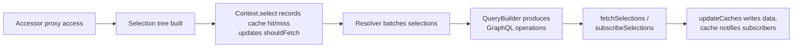

# Core Design

## Purpose

This document describes the architecture of the core package (`packages/gqty`)
as it exists today. It explains the role of the core package in the monorepo,
the concept of `context` as the execution boundary of an isolated query, the
runtime flow from accessor proxy to cache update, and the relationship between
core and the framework adapters built on top of it.

It is mostly a description of current behavior. A smaller
`Implementation Intentions` section at the end records the user's stated
direction for keeping core framework-neutral.

See also: [React Design](ReactDesign.md), [Solid Design](SolidDesign.md).

## Package Role In The Monorepo

`packages/gqty` is the architectural center of the monorepo. It is a
self-sufficient GraphQL client runtime that can be used directly through
`createClient()` and the public methods it returns:

- `client.resolve(fn, options)` — run a query, mutation, or subscription as a
  one-off promise.
- `client.subscribe(fn, options)` — run the same kinds of operations as an async
  iterable that continues to track cache changes.
- `client.schema` — a long-lived accessor proxy backed by a client-wide context,
  used for ad-hoc reads against the cache.
- `client.cache` — the cache instance shared by the client.
- `client.subscribeDebugEvents` — observation hook used by `@gqty/logger` and
  `useMetaState` in the React adapter.

`packages/gqty/src/Client/index.ts` wires these together:

- It constructs a single client-wide `SchemaContext` via `createContext()` and
  uses it to back `client.schema`.
- It constructs `resolvers` via `createResolvers()` and exposes the resulting
  `createResolver`, `resolve`, and `subscribe` functions.
- It also installs `createPersistors()` and a legacy compatibility surface
  through `createLegacyClient()`.

Other packages depend on this surface:

- `packages/react` and `packages/solid` are framework adapters built on top of a
  core client; they own no GraphQL runtime of their own.
- `packages/cli` generates the typed schema modules consumed by `createClient()`
  but is otherwise independent of runtime concerns.
- `packages/logger` subscribes to `client.subscribeDebugEvents`.
- `packages/subscriptions` provides a transport client compatible with the
  `subscriber` slot in `FetchOptions`.

The core package is therefore both the central runtime and the contract that
adapters and tooling rely on.

## Core Concepts

The core runtime is built around five collaborating concepts:

- **selection** — a node in a tree of intended GraphQL field accesses, produced
  by the accessor proxy and consumed by the query builder. See
  `packages/gqty/src/Selection.ts`.
- **accessor** — a proxy over the generated schema that turns property access
  and function calls into selections, while reading current values from the
  cache. See `packages/gqty/src/Accessor/index.ts` and
  `packages/gqty/src/Accessor/resolve.ts`.
- **context** — the per-execution boundary that owns the selection set, cache
  reference, depth limit, scalars/schema, and the
  `shouldFetch`/`hasCacheHit`/`hasCacheMiss`/`notifyCacheUpdate` flags. See
  `packages/gqty/src/Client/context.ts`.
- **resolver** — the unit of orchestration created by `createResolver()` that
  owns one isolated context, batches selections into a fetch, applies results to
  the cache, and exposes `resolve`/`subscribe` callbacks. See
  `packages/gqty/src/Client/resolvers.ts`.
- **cache** — a normalization-aware store with TTL, stale-while-revalidate,
  per-key subscriptions, and snapshot persistence. See
  `packages/gqty/src/Cache/index.ts`.

`runtime` in this document refers to the in-process collaboration of these
concepts: accessor → selection → resolver/context → query builder →
fetch/subscription → cache update → notification.

## Context And Isolated Queries

`SchemaContext` (defined in `packages/gqty/src/Client/context.ts`) is the
execution boundary for an isolated query. Each context owns:

- A `cache` reference. For most cache policies this is the shared client cache.
  For `no-cache`, `no-store`, and `reload`, `createContext()` substitutes a
  temporary in-memory `Cache` so the resolver's reads and writes do not leak
  into the client cache.
- `cacheOptions` derived from the cache policy (e.g. `includeExpired` for
  `default`, `force-cache`, and `only-if-cached`).
- A `select(selection, cacheNode)` function that updates `shouldFetch`,
  `hasCacheHit`, `hasCacheMiss`, and `notifyCacheUpdate` based on cache
  freshness, then notifies subscribers registered via `subscribeSelect`.
- `reset()` and `dispose()` lifecycle hooks plus `subscribeDispose`.

There are two ways contexts are used:

1. **Client-wide context.** `createClient()` calls `createContext()` once and
   uses the resulting context to back `client.schema` (the global accessor). It
   is long-lived; it accumulates `select` notifications across the lifetime of
   the client and is not tied to any single operation.
2. **Per-resolver isolated context.** Every call to `createResolver()` (used
   internally by `resolve()`, `subscribe()`, and React's `useQuery`) constructs
   a fresh `SchemaContext` for that resolver. Its selection set, `shouldFetch`
   flag, and (in some cache policies) its cache instance are private to that
   resolver. The resolver wires `context.subscribeSelect` so it accumulates
   selections in its own `Set`, and conditionally forwards selections to a
   `parentContext` (the client-wide context) so client-level observers can still
   see them.

This is the basis for treating an isolated query as a core concept rather than a
framework concept. Each `resolve()` or `subscribe()` invocation owns its own
context with its own selections and execution state. Framework adapters consume
this isolation; they do not define it.

## Selection Capture

`packages/gqty/src/Selection.ts` defines `Selection`, a tree node with a `key`,
optional alias and input, and a `children` map. Selections are created lazily as
the accessor proxy is walked. Each `Selection` carries `cacheKeys`
(`[type, field, …]`) used both for cache reads and for query building.

The accessor (`packages/gqty/src/Accessor/index.ts` and `Accessor/resolve.ts`)
is a `Proxy` over the generated schema:

- Property access on a root key (`query`, `mutation`, `subscription`) produces
  or reuses a root `Selection`, then returns an object accessor via
  `createObjectAccessor()`.
- Further property access and function calls walk into child selections,
  applying argument hashing and depth-limit checks.
- Each access calls `context.select(selection, cacheNode)` so the context can
  update its `shouldFetch`/`hasCacheHit` state and notify subscribers (which
  include the per-resolver selection set in `Client/resolvers.ts`).

The result is that simply reading from `accessor.query.foo.bar` records the
intent to fetch `query { foo { bar } }` and returns either the cached value or a
placeholder skeleton.

## Runtime Flow

At a high level, core moves through four stages:

Concrete touch points:

1. **Selection capture.** Accessor proxy walks (`Accessor/resolve.ts`) create or
   reuse `Selection` nodes (`Selection.ts`) and call `context.select` on each
   access (`Client/context.ts`).
2. **Resolver batching.** The resolver in `Client/resolvers.ts` collects
   selections into its private `Set<Selection>`, debounces fetch starts via
   `debounceMicrotaskPromise` and a configurable `batchWindow`, and uses a
   module-level `pendingQueries` map keyed by the shared selections set so
   multiple resolvers with the same operation name (or no operation name) share
   one network call.
3. **Query construction and dispatch.** `fetchSelections` and
   `subscribeSelections` (`Client/resolveSelections.ts`) call `buildQuery()`
   (`QueryBuilder.ts`) to produce one or more `QueryPayload` objects,
   deduplicate identical inflight queries via `dedupePromise`, then dispatch
   through the configured `fetcher` or `subscriber`.
4. **Cache update.** `updateCaches()` (`Client/updateCaches.ts`) writes each
   result into one or more caches (the client cache, plus any temporary caches
   created for `no-cache`/`no-store` resolvers), and propagates GraphQL errors.
   Successful writes call `cache.set(..., { skipNotify })`; cache subscribers
   receive notifications keyed by the affected cache paths.

After a successful fetch, the resolver replaces its `prevSelections` with the
just-fetched selections and clears the active `selections` set so the next pass
starts clean. `context.reset()` clears the per-fetch flags.

For `subscribe()`, the resolver additionally:

- Splits subscription-rooted selections from query/mutation selections so that
  `resolve()` only handles the latter.
- Subscribes to the cache for the selected keys so cache updates triggered by
  other writers also flow through the iterator.
- Calls `subscribeSelections` for subscription-rooted selections and writes
  every incoming payload back through `updateCaches`.

## Cache And Subscription Model

The cache (`packages/gqty/src/Cache/index.ts`) is more than a key-value store.
It owns:

- A normalized object graph (when `normalization` is enabled), with per-type key
  extraction.
- TTL with `expiresAt` and an optional `staleWhileRevalidate` window.
  `MINIMUM_CACHE_AGE` clamps very small ages to avoid render/fetch loops.
- `WeakRef`/`FrailMap`-backed entries that allow garbage collection of
  unreferenced data.
- Per-path subscriptions used by both core (subscription resolvers re-emit on
  cache change) and adapters (e.g. `useQuery` subscribes to the cache paths
  derived from its current selections).
- Snapshot import/export through `Cache/persistence.ts`, surfaced as
  `client.hydrateCache`/`client.prepareRender` via the persistors.

Subscription support inside the resolver layer (`createSubscriber`,
`subscribeSelections`) integrates `graphql-ws` and `graphql-sse` clients through
the `subscriber` field of `FetchOptions`. Subscription messages flow into the
same `updateCaches` pipeline as fetch results, so listeners of the cache see the
same update path regardless of transport.

## Integration Points For Adapters And Plugins

A few exports from the core package are deliberately shaped as integration
points for library and plugin authors (framework adapters, devtools, custom
transports). They are part of the package's public surface even though they sit
below `resolve()`/`subscribe()` in abstraction.

- **`createResolver`** (`packages/gqty/src/Client/resolvers.ts`, returned from
  `createResolvers()` and exposed on the client). This is the primitive that
  `resolve()` and `subscribe()` themselves are built on, and it is the intended
  entrypoint for adapters that need to own the resolver lifecycle from outside
  core. It returns the isolated `context`, the `accessor` proxy, the live
  `selections` set, `resolve`/`subscribe` callbacks, and helpers like
  `restorePreviousSelections`. Both the React adapter (`useQuery`,
  `useSubscription`) and the Solid adapter (`createQuery`, `createSubscription`)
  consume it directly. New adapters and plugins that need finer control than
  `client.resolve()`/`client.subscribe()` are expected to use `createResolver`
  rather than reach further into core internals.
- **`$meta`** (`packages/gqty/src/Accessor/meta.ts`, re-exported from
  `packages/gqty/src/Client/index.ts`). This is the documented escape hatch for
  reading the `Meta` record (`context`, `cache`, `selection`, `type`) attached
  to any accessor proxy value. Adapter and plugin code uses `$meta` to recover
  the originating `Selection`, the underlying cache node, or the `SchemaContext`
  from a value that came out of the accessor — for example to derive cache
  subscription keys, reconstruct selection ancestry, or attach extra behavior to
  values produced by `client.schema`. The React adapter uses it in `client.ts`
  and `common.ts`; core itself uses it in the legacy `refetch` and
  `hydrateCache` compatibility paths.
- **`prepass`** (`packages/gqty/src/Helpers/prepass.ts`, re-exported from
  `Client/index.ts`). Walks an accessor value (or a `Set<Selection>`) and forces
  property/function access along the supplied paths so that selections are
  registered before something else (a render, an HOC, a `prepare` callback)
  observes them. Both the React adapter (`useQuery`'s `prepare` plumbing) and
  the Solid adapter (`createQuery`'s `prepare`/soft-refetch path) call it
  through this same export.

  `prepass` is part of the current public API and adapters depend on it today.
  The intention is to deprecate it once it is no longer strictly necessary —
  i.e. once selection capture for `prepare`-style flows can be expressed
  entirely through the accessor and resolver primitives without an explicit
  prewalk helper. New core features should not be designed around `prepass`
  remaining; existing usages may continue until that replacement exists.

These three exports — `createResolver`, `$meta`, and `prepass` — are the primary
surface that library and plugin authors are expected to use when they need to
extend core without modifying it. They should be treated as part of the core
contract, with the same consistency requirements as
`resolve()`/`subscribe()`/`schema`/`cache`.

## Relationship To Other Packages

The core package is the only package that owns GraphQL runtime behavior. Other
packages relate to it as follows:

- **`packages/react`** — adapter. Imports the public client surface
  (`createClient`'s return type, `createResolver`, `resolve`, `subscribe`,
  `schema`, `cache`, `subscribeDebugEvents`) and a few internal modules
  re-exported from `gqty` (`prepass`, `$meta`, `getActivePromises` from
  `gqty/Cache/query`). It does not define new GraphQL semantics; it translates
  core state into React hooks and lifecycle. See `docs/ReactDesign.md` for the
  full breakdown.
- **`packages/solid`** — adapter. Built on the same core primitives for Solid's
  reactive model. See `docs/SolidDesign.md` for the full breakdown.
- **`packages/cli`** — codegen. Produces the typed schema descriptors consumed
  by `createClient()`; runs at build time and has no runtime coupling.
- **`packages/logger`** — observability. Calls `client.subscribeDebugEvents` to
  print fetches and cache activity. No runtime hooks beyond the public debug
  event stream.
- **`packages/subscriptions`** — transport. Provides a subscription client
  compatible with the `subscriber` slot in `FetchOptions`.

The wiring example at `examples/react/src/components/client.ts` shows the
expected layering: a generated client (`gqty`) is created once, then
`createReactClient()` is called over it and the framework-neutral pieces
(`resolve`, `subscribe`, `schema`, `cache`, legacy helpers) remain directly
accessible alongside the React hooks.

## Implementation Intentions

The following items record the user's stated architectural direction for the
core package. They are not all reflected in current code; they describe the lens
through which future changes should be evaluated.

1. **Core is first and foremost a self-sufficient library.** `resolve()` and
   `subscribe()` are the primary user-facing entrypoints, usable without any
   framework adapter. Every other surface (legacy compat, debug events,
   persistors) exists to support that self-sufficiency.
2. **Adapters may import lower-level core internals when those internals are
   framework-neutral.** Today the React adapter consumes `createResolver`,
   `$meta`, and `prepass` directly, while the Solid adapter consumes
   `createResolver` and `prepass`. These are intentional integration points (see
   `Integration Points For Adapters And Plugins` above), not incidental seams.
   Other lower-level imports are acceptable on the same bar: the internal must
   be framework-neutral, not adapter-shaped.
3. **Core should expose reusable primitives when they generalize across
   adapters.** When the React adapter or another adapter discovers a missing
   primitive whose shape is broadly valid (cache subscription helpers,
   isolated-query lifecycle helpers, render-safe selection tracking), the
   preferred move is to add it to core rather than re-implement it inside the
   adapter.
4. **Core must not grow features whose only justification is React.** A feature
   is justified for core only when its design is framework-neutral and its
   semantics make sense for `resolve()`/`subscribe()` consumers that have no
   rendering loop at all. React-only ergonomics belong in the React adapter; see
   `docs/ReactDesign.md` for the corresponding direction on the React side.
