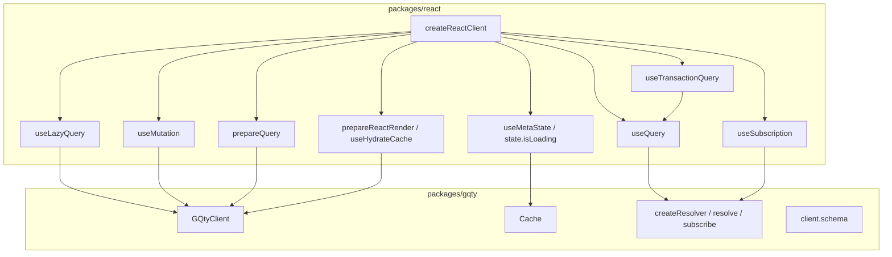

# React Design

## Purpose

This document describes the architecture of the React adapter (`packages/react`)
as it exists today. It explains how the React adapter relates to the core
package, the public surface assembled by `createReactClient()`, the current
implementation boundaries across the hooks, and why `useQuery()` is the
architectural hotspot of the package.

It is mostly a description of current behavior. A smaller
`Implementation Intentions` section at the end records the user's stated
direction for shrinking React-specific runtime ownership.

See also: [Core Design](CoreDesign.md), [Solid Design](SolidDesign.md).

## Package Role In The Monorepo

`packages/react` is a React adapter built on top of an existing core client. It
does not own any GraphQL runtime behavior. Its job is to translate core runtime
state — selections, isolated query contexts, cache subscriptions, fetch
lifecycle, debug events — into React-shaped hooks, helpers, and SSR utilities.

The package is assembled by `createReactClient(client, options)` in
`packages/react/src/client.ts`. The function takes a `GQtyClient<TSchema>` and
returns the `ReactClient<TSchema>` interface, which combines:

- query hooks: `useQuery`, `useTransactionQuery`, `useLazyQuery`,
  `usePaginatedQuery`, `useRefetch`, and `usePrepared` produced by
  `prepareQuery`.
- mutation hook: `useMutation`.
- subscription hook: `useSubscription`.
- meta/loading observation: `useMetaState` and a `state` object.
- HOC: `graphql`.
- SSR helpers: `prepareReactRender` and `useHydrateCache`, both backed by core's
  `prepareRender` and `hydrateCache`.

The public type re-exports from this package are listed in
`packages/react/src/index.tsx`.

The adapter consumes core's documented integration points (`createResolver`,
`$meta`, and `prepass` — see `docs/CoreDesign.md` →
`Integration Points For Adapters And Plugins`) rather than reaching into
otherwise-internal modules. In particular, the `prepare({ prepass, query })`
helper passed into `useQuery` exposes `prepass` so callers can force selections
before render. `prepass` is a current-API integration point and is expected to
be deprecated once selection capture for `prepare`-style flows can be expressed
without an explicit prewalk helper; see the same section in `docs/CoreDesign.md`
for the deprecation intent.

## Public Surface

`createReactClient()` wires the hooks like this:

- `useQuery` is created via `createUseQuery(client, opts)` in
  `query/useQuery.ts`. It is the only hook that holds a per-render isolated
  query lifecycle of its own (see the hotspot section below).
- `useTransactionQuery` is created via
  `createUseTransactionQuery(useQuery, opts)`. It explicitly takes the
  already-created `useQuery` rather than the core client; it is a hook over a
  hook.
- `useLazyQuery` is created via `createUseLazyQuery(client, opts)`. It delegates
  the actual fetch to the core/legacy client surface (the legacy
  `resolved`/`refetch` methods on `GQtyClient`).
- `useMutation`, `usePaginatedQuery`, and `useRefetch` are created from the core
  client and the React defaults.
- `useSubscription` is created from `createUseSubscription(client)` and uses the
  core `subscribe()` runtime.
- `prepareQuery` (`query/preparedQuery.ts`) uses `client.prefetch`,
  `client.refetch`, and `query` together with a small external
  `createMemoryStore` and `useSyncExternalStore` to expose a prepared query
  state.
- `prepareReactRender` and `useHydrateCache` (`ssr/ssr.ts`) delegate directly to
  core's `prepareRender` and `hydrateCache`.
- `state.isLoading` reads `getActivePromises(cache)` from `gqty/Cache/query`,
  i.e. it observes core state, it does not own it.

This is the layered picture:

## Current Implementation Boundaries

Most React hooks are already relatively thin wrappers over the core package:

- `useLazyQuery` wraps the legacy `resolved`/`refetch` surface and a small
  reducer; it does not manage selections directly.
- `useTransactionQuery` is a wrapper over `useQuery` and adds polling, skip, and
  `onCompleted`/`onError` semantics. It does not touch core directly except for
  shared types.
- `prepareQuery` and the SSR helpers delegate to core's
  `prefetch`/`refetch`/`prepareRender`/`hydrateCache` and use a small external
  store + `useSyncExternalStore`.
- `useSubscription` calls core's `subscribe()` and translates its async iterator
  into React state.
- `useMetaState` and `state.isLoading` derive from core debug events and the
  core cache's `getActivePromises`.

The clear exception is `useQuery()`, which currently absorbs the bulk of the
React adapter's runtime responsibility.

## `useQuery()` As The Architectural Hotspot

`useQuery()` (`packages/react/src/query/useQuery.ts`) is the most complex hook
in the package. Within a single hook body it currently manages all of the
following:

1. **Per-render resolver and isolated context construction.** It calls
   `client.createResolver(...)` inside `useMemo` keyed on `cachePolicy`,
   `operationName`, and `retryPolicy`, producing a resolver whose `context` is
   the isolated query context for this hook instance.
2. **Render-time selection capture.** It passes a custom `onSelect` into
   `createResolver` that:
   - tracks a module-level `resolverStack` and `cofetchingResolvers` `MultiDict`
     so that resolvers active in the same render can co-fetch when the cache is
     not normalized;
   - distinguishes selections happening during render from selections happening
     outside render (event handlers, polling) and triggers an out-of-render
     refetch in the latter case;
   - clears stale selections once on the first selection of a non-fetch render;
   - flips `context.shouldFetch` to true for cache policies that require it
     (`reload`, `no-cache`, `no-store`).
3. **Suspense delivery.** When `suspense` is enabled and the cache misses (or
   `notifyOnNetworkStatusChange` is set), it throws `state.promise` so React
   unwinds to the nearest `Suspense` boundary. With `prepare`, it throws an
   explicit `client.resolve(...)` promise so suspension happens on the first
   render rather than after a re-render.
4. **ErrorBoundary delivery.** When `suspense` is enabled and a fetch error is
   captured into `state.error`, it `throw`s the error from the hook body so it
   surfaces to the nearest error boundary.
5. **Cache subscription.** It uses `useEffect` to call
   `context.cache.subscribe(...)` on the cache keys derived from the current
   selection set, with `useRerender()` as the listener.
6. **Refetch trigger handling.** It owns a large `refetch` callback that manages
   a single-flight mutex on `state.promise`, applies the
   `cachePolicy`/`hasCacheMiss`/`hasCacheHit` rules to decide whether a fetch
   actually runs, performs the cache-key stitching for non-normalized caches,
   calls `resolve()` on this resolver and any co-fetching resolvers, and resets
   `context` and the resolver stacks afterwards.
7. **Render hooks for refetch sources.** It coordinates `useEffect`,
   `useIntervalEffect`, `useOnlineEffect`, `useWindowFocusEffect`, and
   `useUpdateEffect` for the various refetch triggers (`refetchOnRender`,
   `refetchInterval`, `refetchOnReconnect`, `refetchOnWindowVisible`, legacy
   `staleWhileRevalidate`).
8. **Imperative `$refetch` and `$state` surface.** It returns a frozen proxy
   that exposes `$refetch` and `$state` while transparently falling through to
   the resolver's `query` accessor (or, for `prepare` users without `no-store`,
   the global `client.schema.query` accessor) for field reads.
9. **Initial loading, prepare, and stale-selection housekeeping.** It tracks
   `initialStateRef`, runs the optional `prepare(...)` callback inside the
   render, and uses a per-render `useRenderSession` to distinguish first
   selection from post-fetch render and to suppress SWR re-fetches on
   render-induced re-runs.

These responsibilities — selection capture during render, resolver lifecycle,
refetch policy, cache subscriptions, Suspense throwing, ErrorBoundary throwing,
imperative refetch, and proxy field forwarding — all live inside one hook body.
That makes `useQuery()` the single largest divergence between the React adapter
and the otherwise thin pattern used by the rest of the package, and it is the
part most likely to race or fight React's rendering model under StrictMode,
concurrent rendering, or nested Suspense.

## Other React Query APIs

- **`useTransactionQuery`** (`query/useTransactionQuery.ts`) calls `useQuery`
  internally with the configured `cachePolicy`, then layers `skip`,
  `pollInterval`, `pollInBackground`, `onCompleted`, and `variables` semantics
  on top. It does not own a resolver itself.
- **`useLazyQuery`** (`query/useLazyQuery.ts`) is intentionally imperative. Its
  reducer state (`loading` / `success` / `failure` / `cache-found`) is
  React-local; the actual fetch flows through the legacy resolved/refetch
  surface on the core client. It does not manage selections in the React tree.
- **`useRefetch`** is a small wrapper over the legacy `refetch` on the core
  client.
- **`useMutation`** wraps the core client's mutation handling and exposes
  React-shaped state.
- **`useMetaState`** subscribes to the core client's debug event stream and
  surfaces aggregated meta state to React. The `state.isLoading` accessor
  exposed by `createReactClient()` is derived directly from
  `getActivePromises(cache)`.

## SSR And Render Integration

- **`prepareReactRender`** (`ssr/ssr.ts`) selects the appropriate React 18
  streaming API (`renderToReadableStream` or `renderToPipeableStream`) or falls
  back to `react-ssr-prepass` for older versions, and calls
  `client.prepareRender(renderFn)`. Returning a `cacheSnapshot` is delegated to
  the core client.
- **`useHydrateCache`** is a thin wrapper around the legacy `hydrateCache` on
  the core client, plus an optional `shouldRefetch`/`refetchAfterHydrate`
  follow-up using `client.refetch`.
- **`prepareQuery`** (`query/preparedQuery.ts`) uses
  `client.prefetch`/`client.refetch` together with a small `createMemoryStore`
  and `useSyncExternalStore` to expose a query whose state survives between
  render trees.

These three areas already align with the thin wrapper direction described below
— they translate core lifecycle into React semantics rather than re-implementing
query behavior.

## Implementation Intentions

The following items record the user's stated architectural direction for the
React adapter. They are not all reflected in the current implementation; they
describe the lens through which future changes should be evaluated.

1. **Avoid fighting React's rendering model.** The current `useQuery()` actively
   negotiates with render passes (post-fetch flags, render sessions, mid-render
   selection clears, manual cache-key stitching for co-fetching resolvers). The
   preferred direction is to design persistence and state ownership so that
   React's rendering rules do not need to be worked around at hook level.
2. **Move broadly valid primitives into core.** Where today `useQuery()`
   re-implements logic that is fundamentally about selection tracking, isolated
   query lifecycle, or render-safe cache observation, the preferred move is to
   expose a framework-neutral primitive from the core package (see
   `docs/CoreDesign.md`) and consume it from React.
3. **Make `useQuery()` a thin wrapper.** If core can supply enough
   framework-neutral primitives, `useQuery()` should shrink into a thin wrapper
   that translates runtime state (selections, fetch lifecycle, cache
   subscriptions, errors) into React semantics (`useState`,
   `useSyncExternalStore`, Suspense throws, error boundary throws), the way
   `useTransactionQuery`, `useLazyQuery`, `prepareQuery`, and the SSR helpers
   already do.
4. **React translates; React does not own.** The React adapter should remain a
   translation layer over core. Adapter-shaped behavior (suspense, error
   boundary throwing, render-loop coordination) stays in the adapter.
   Query-runtime behavior (selection capture semantics, isolated query context
   lifecycle, cache update propagation) belongs in core.
5. **Any primitive moved into core must remain framework-neutral.** Adding to
   core for the sake of React alone is not the goal; if a proposed primitive
   does not also make sense for direct `resolve()`/`subscribe()` consumers and
   other adapters, it does not belong in core. In that case it stays inside the
   React adapter.
