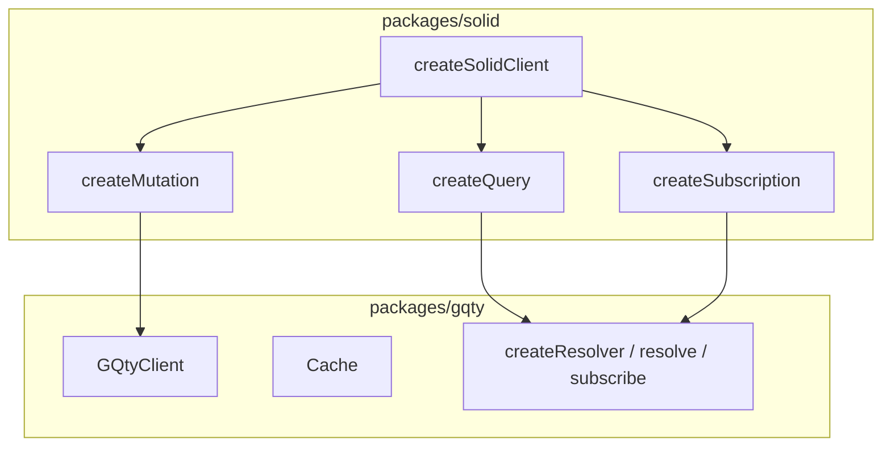

# Solid Design

## Purpose

This document describes the architecture of the Solid adapter (`packages/solid`)
as it exists today. It explains how the Solid adapter relates to the core
package, the public surface assembled by `createSolidClient()`, and the
implementation boundaries across `createQuery`, `createMutation`, and
`createSubscription`.

It is mostly a description of current behavior. A smaller
`Implementation Intentions` section at the end records the user's stated
direction for keeping the Solid adapter a thin wrapper over core.

See also: [Core Design](CoreDesign.md), [React Design](ReactDesign.md).

## Package Role In The Monorepo

`packages/solid` is a Solid.js adapter built on top of an existing core client.
It does not own any GraphQL runtime behavior. Its job is to translate core
runtime state — selections, isolated query contexts, cache subscriptions, fetch
lifecycle — into Solid-shaped primitives (`createSignal`, `createResource`,
`createEffect`, `onMount`, `onCleanup`, `batch`).

The package is assembled by `createSolidClient(client, options)` in
`packages/solid/src/index.ts`. The function takes a `Client<TSchema>` (the core
`GQtyClient`) and returns a `SolidClient<TSchema>` that exposes three
primitives:

- `createQuery` — live query factory; see `packages/solid/src/query.ts`.
- `createMutation` — imperative mutation factory; see
  `packages/solid/src/mutation.ts`.
- `createSubscription` — live subscription accessor factory; see
  `packages/solid/src/subscription.ts`.

The adapter consumes core's documented integration points (`createResolver`,
`prepass`; see `docs/CoreDesign.md` →
`Integration Points For Adapters And Plugins`) rather than reaching into
otherwise-internal modules.

## Public Surface

`createSolidClient()` is a small assembly function. It calls the three factory
creators with the same `client` and `options` and returns their results:

`SolidClientOptions` currently carries only `defaults` (`cachePolicy`,
`retryPolicy`). `CommonOptions` (`extensions`, `operationName`) and
`DefaultOptions` (`cachePolicy`, `retryPolicy`) are shared types that each
factory option type extends.

## `createQuery`

`createQuery` (`packages/solid/src/query.ts`) is the most involved primitive in
the package — it is the Solid analog of React's `useQuery`, and it owns a
per-instance isolated query lifecycle. Within a single factory call it currently
manages all of the following:

1. **Per-instance resolver and isolated context construction.** It calls
   `client.createResolver({...})` once per `createQuery()` call, producing an
   isolated `context`, `accessor`, `selections`, `subscribe`, `resolve`, and
   `restorePreviousSelections`.
2. **Selection-driven soft refetch.** It passes a custom `onSelect` to the
   resolver that schedules `$refetch({ skipPrepass: true })` through a debounced
   microtask whenever selections are made outside of the Solid lifecycle. When
   `prepare` is provided, `onSelect` returns `false` to suppress all selections
   that did not come from the `prepare` callback.
3. **`createResource`-backed render integration.** It owns a
   `createResource(() => resolvePromise, { storage })` whose `refetch` is
   enqueued via a microtask-debounced `batch()` so multiple pending updates
   collapse into a single Solid update.
4. **`$refetch` semantics.** The internal
   `$refetch({ ignoreCache, skipPrepass })` flips `context.shouldFetch` when
   `ignoreCache` is set or the resolver is using a temporary cache, optionally
   re-runs `prepass(accessor, selections)` (or the user
   `prepare(accessor, { prepass })`) to refresh cache freshness against the live
   cache, then either bails out (selections empty / no `shouldFetch`) or wires a
   fresh `subscribe(...)` and resolves a `p-defer` deferred from its
   `onNext`/`onError`/`onComplete` callbacks.
5. **Refetch triggers.** It schedules an initial
   `$refetch({ skipPrepass: true })` from `onMount` (the equivalent of React's
   `refetchOnRender`), and conditionally registers:
   - `createIntervalEffect(() => $refetch(), refetchInterval)` for periodic
     refetch (`packages/solid/src/createIntervalEffect.ts`).
   - A `createEffect` over `createOnlineSignal()` for `refetchOnReconnect`
     (`packages/solid/src/createOnlineSignal.ts`).
   - A `createEffect` over `createWindowVisibleSignal()` for
     `refetchOnWindowVisible`
     (`packages/solid/src/createWindowVisibleSignal.ts`).
6. **`prepare` integration.** When `prepare` is supplied, it is invoked once
   during factory setup with `context.shouldFetch` reset, with the `prepare`
   lock temporarily released so the callback's selections are recorded; if any
   of them flip `context.shouldFetch`, an initial `resolve()` is started
   immediately and its promise becomes the first `resolvePromise`.
7. **Cleanup.** `onCleanup(() => unsubscribe?.())` releases the active subscribe
   handle from the resolver when the owning Solid scope disposes.
8. **Public surface.** The returned callable is
   `() => resource()?.query ?? accessor.query`, augmented with:
   - `$state.loading` and `$state.error` proxied from the resource.
   - `$refetch(ignoreCache = true)` which is mutex-guarded against
     `resolvePromise`, restores `prevSelections` via
     `restorePreviousSelections()`, and delegates to internal `$refetch`.

The combination of selection-driven soft refetch, `createResource` integration,
and the `prepare`/`prepass` interaction make `createQuery` the primary
complexity hotspot in the Solid adapter, in the same way that `useQuery` is for
the React adapter.

## `createMutation`

`createMutation` (`packages/solid/src/mutation.ts`) is intentionally minimal.
The factory takes a `mutate(mutation, ...args)` function and returns an async
function that calls
`client.resolve(({ mutation }) => mutate(mutation!, ...args), { ...defaults, ...options })`.
It owns no Solid-specific state, no resolver lifecycle, and no cache
subscriptions of its own — it is a thin pass-through to `client.resolve()`.

## `createSubscription`

`createSubscription` (`packages/solid/src/subscription.ts`) owns one resolver
per factory invocation, the same way `createQuery` does, but its update path is
much smaller:

1. It calls `client.createResolver({...})` and reuses the resulting `accessor`,
   `selections`, and `subscribe`.
2. Its `onSelect` is wrapped in
   `debounceMicrotask(..., { limitAction: 'ignore' })`. When fired, if
   `selections.size > 0`, it tears down any previous `unsubscribeFetch` and
   re-runs `subscribe({...})` so the underlying subscription always reflects the
   current selection set.
3. Each `onNext` from the resolver calls `trigger()` on a `createSignal` created
   with `{ equals: false }`, forcing a Solid re-track.
4. `onError` defaults to rethrowing; `onComplete` is forwarded.
5. `onCleanup(() => unsubscribeFetch?.())` releases the subscribe handle.
6. The returned accessor is `() => { track(); return accessor.subscription; }`.

## Helper Signals And Effects

Three small Solid utilities back the refetch trigger options on `createQuery`:

- `createIntervalEffect(fn, interval, getArguments?)` —
  `packages/solid/src/createIntervalEffect.ts`. Wraps `setInterval` in
  `onMount`/`onCleanup`.
- `createOnlineSignal()` — `packages/solid/src/createOnlineSignal.ts`. Tracks
  `navigator.onLine` through `online`/`offline` listeners on `globalThis`.
- `createWindowVisibleSignal()` —
  `packages/solid/src/createWindowVisibleSignal.ts`. Tracks `!document.hidden`
  through a `visibilitychange` listener on `document`.

These are private to the package and exist only to feed the corresponding
`refetchInterval`, `refetchOnReconnect`, and `refetchOnWindowVisible` options on
`createQuery`.

## Relationship To Core

The Solid adapter is structurally analogous to the React adapter (see
`docs/ReactDesign.md`):

- Both build on the same core integration points: `createResolver`,
  `client.resolve`, `client.subscribe`, `client.cache`, and `prepass` (and, on
  the React side, `$meta`).
- Both isolate per-instance query state inside a resolver-owned `SchemaContext`
  (the per-resolver isolated context defined in `docs/CoreDesign.md` →
  `Context And Isolated Queries`).
- Both translate that context's lifecycle into framework-native primitives —
  hooks for React, signals/resources/effects for Solid.
- Both keep `createMutation`/`useMutation` as thin pass-throughs to
  `client.resolve()`, and keep `createSubscription`/`useSubscription` as a small
  reactive bridge over the resolver's `subscribe`.

The clear analog of the React `useQuery` hotspot is `createQuery`: it is the
single primitive in the Solid adapter that owns selection capture coordination,
refetch policy, the `prepare`/`prepass` interaction, and a `createResource`
integration in one body.

## Implementation Intentions

The following items record the user's stated architectural direction for the
Solid adapter. They are not all reflected in current code; they describe the
lens through which future changes should be evaluated.

1. **Solid translates; Solid does not own.** The adapter should remain a
   translation layer over core. Adapter-shaped behavior (signal/resource
   integration, `onMount`/`onCleanup` wiring, `batch()` coordination) stays in
   the adapter. Query-runtime behavior (selection capture semantics, isolated
   query context lifecycle, cache update propagation) belongs in core.
2. **Prefer framework-neutral primitives in core.** Where `createQuery`
   re-implements logic that is fundamentally about selection tracking, isolated
   query lifecycle, or cache observation, the preferred direction is to add a
   framework-neutral primitive to core (see `docs/CoreDesign.md` →
   `Implementation Intentions`) and consume it from Solid, the same way the
   React adapter is intended to.
3. **Keep `createMutation` and `createSubscription` thin.** Their current shape
   — a direct wrap of `client.resolve()` and a minimal resolver+signal bridge —
   is the intended steady state.
4. **`prepass` is current API, not a long-term commitment.** `createQuery` calls
   `prepass(accessor, selections)` (and exposes it to `prepare`) to register
   selections before the resource resolves. `prepass` is expected to be
   deprecated once selection capture for `prepare`-style flows can be expressed
   without an explicit prewalk helper; see `docs/CoreDesign.md` →
   `Integration Points For Adapters And Plugins`. New Solid features should not
   be designed around `prepass` remaining.
